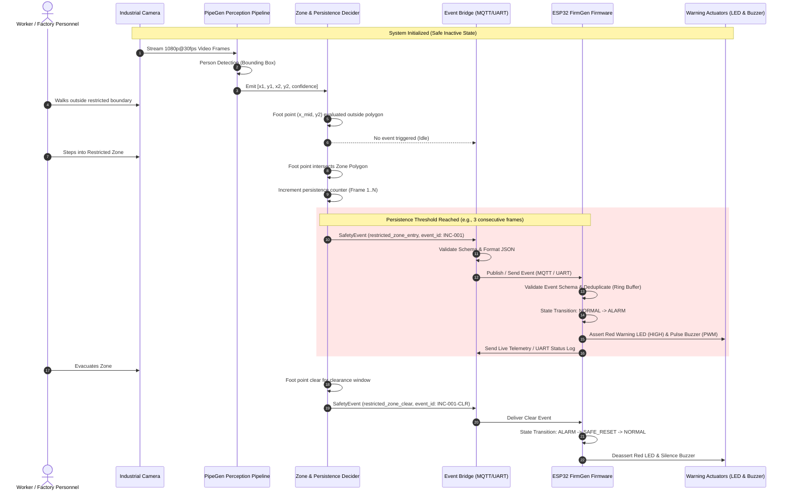

# SafeGuard AI — Physical AI Safety Sentinel Architecture

## 1. System Overview

SafeGuard AI is an industrial-grade Physical AI Safety Sentinel designed to enforce real-time exclusion zones around heavy manufacturing equipment. It creates a deterministic, closed-loop safety architecture:

```
[PERCEIVE] Camera Feed (UVC / RTSP / Video)
       │
       ▼
[ANALYZE] PipeGen Vision Pipeline (TensorRT / DeepStream / YOLO)
       │
       ▼
[DECIDE] Foot-Point Polygon Intersection & Temporal Persistence Filter
       │
       ▼
[COMMUNICATE] SafeGuard Event Bridge (MQTT / Serial / Mock Transport)
       │
       ▼
[ACT] FirmGen-Synthesized ESP32 Firmware (FSM / Dual-Stage Warning Outputs)
       │
       ▼
[VERIFY] Live Telemetry, Closed-Loop Verification & Alarm Reset Policy
```

---

## 2. End-to-End Sequence Diagram



---

## 3. Component Decomposition

### Component A: PipeGen Perception Pipeline
- **Input**: Live USB/CSI camera, RTSP stream, or prerecorded factory video file.
- **Stage 1 (Requirement)**: Latency constraint <= 35ms, target 30 FPS, class 0 (Person), FP16/INT8 precision.
- **Stage 2 (Pipeline IR)**: Declarative graph connecting GStreamer source, nvstreammux, nvinfer (TensorRT engine), nvdsanalytics (polygon zones), and custom event probe.
- **Stage 3 (Model)**: Person detection neural network with calibration parameters.
- **Stage 4 (Compiler)**: Optimized TensorRT execution plan using PipeGen compiler.
- **Stage 5 (Run)**: Real-time execution with bounding box extraction and metadata generation.

### Component B: Spatial-Temporal Decision Engine & Safety Event Bridge
- **Foot-Point Ingestion**: Bottom-center coordinate calculation:
  $$P_{foot} = \left(\frac{x_{min} + x_{max}}{2}, y_{max}\right)$$
  Using the bottom-center avoids false alerts caused by worker heads or outstretched arms extending into a safety polygon while feet remain in safe walkways.
- **Polygon Intersection**: 2D ray-casting point-in-polygon validation against configured zone vertices.
- **Temporal Persistence**: Requires $N$ consecutive positive frames (or $T$ ms) to prevent noise spikes from triggering physical alarms.
- **Duplicate Suppression**: Tracks active incident state and sequence IDs.
- **Transport Abstraction**: Plug-and-play abstraction supporting:
  - `MqttTransport`: Production networked transport using Paho-MQTT.
  - `SerialTransport`: Hardware UART transport for direct ESP32 USB/TTL link.
  - `MockTransport`: In-memory thread-safe queue for zero-hardware simulation tests.

### Component C: FirmGen-Synthesized Embedded Firmware (ESP32)
- **Target Platform**: Espressif ESP32 dual-core Xtensa LX6 / ESP32-S3.
- **Framework**: ESP-IDF v5.5 (Embedded C/C++, FreeRTOS).
- **FirmGen Requirements**: Formal PRD (REQ-001 through REQ-010) mapped to generated code blocks.
- **Fail-Safe Design**:
  - Boot state: All actuators guaranteed LOW.
  - Ring buffer for event deduplication (16-event history).
  - Watchdog timer: If communication is lost while in alarm, auto-recovery or fail-safe timeout applies.
  - Actuator control: Red Beacon LED (GPIO 2 / 21) and Piezo Buzzer (GPIO 5 / 18).
- **Telemetry**: Live Intelligence output emitting JSON telemetry packets over UART every 1000ms.

---

## 4. Latency Budget & Timing Constraints

| Phase | Description | Target Latency | Max Allowed |
| :--- | :--- | :--- | :--- |
| **Capture & Transfer** | Camera frame acquisition & DMA buffer | 10 ms | 20 ms |
| **Inference (PipeGen)** | TensorRT FP16 person detection | 12 ms | 25 ms |
| **Zone Evaluation** | Foot-point calculation & polygon ray casting | 1 ms | 3 ms |
| **Persistence Filter** | 3-frame validation buffer | 66 ms (at 30fps) | 100 ms |
| **Serialization & Egress** | JSON serialization & MQTT/UART dispatch | 2 ms | 5 ms |
| **Network / Serial Transfer** | Broker latency or UART at 115200 baud | 5 ms | 15 ms |
| **Firmware Ingestion & FSM** | JSON parsing, deduplication, GPIO assert | 2 ms | 5 ms |
| **Physical Actuation** | LED on, Piezo diaphragm oscillation | 1 ms | 2 ms |
| **Total Closed-Loop Time** | Initial breach to physical buzzer buzz | **~99 ms** | **< 175 ms** |
