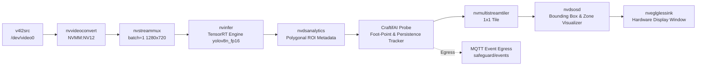

# PipeGen Stage 2: Pipeline Intermediate Representation (IR)

**Tool**: CraftifAI PipeGen v0.5.1  
**Stage**: 2 — Pipeline IR Generation

---

## 1. Intermediate Representation Graph Visualization

## 2. IR Node Specification

- **Input Node (`v4l2src`)**: Ingests 30 FPS video directly from industrial UVC sensor or RTSP bridge.
- **Hardware Acceleration (`nvvideoconvert` + `nvstreammux`)**: Converts raw frames into unified NVMM GPU memory buffers, eliminating host-to-device memory copies.
- **Inference Node (`nvinfer`)**: Runs the compiled TensorRT execution engine with sub-15ms latency per frame.
- **Custom Analytics Probe (`craftifai_probe`)**: Intercepts DeepStream frame metadata (`NvDsFrameMeta` and `NvDsObjectMeta`), extracts bottom-center bounding-box coordinates $(x_{mid}, y_{max})$, evaluates polygon ray casting, updates temporal persistence counters, and dispatches JSON events to MQTT.
- **On-Screen Display (`nvdsosd`)**: Visualizes safe areas in translucent green and breached zones in solid red.
